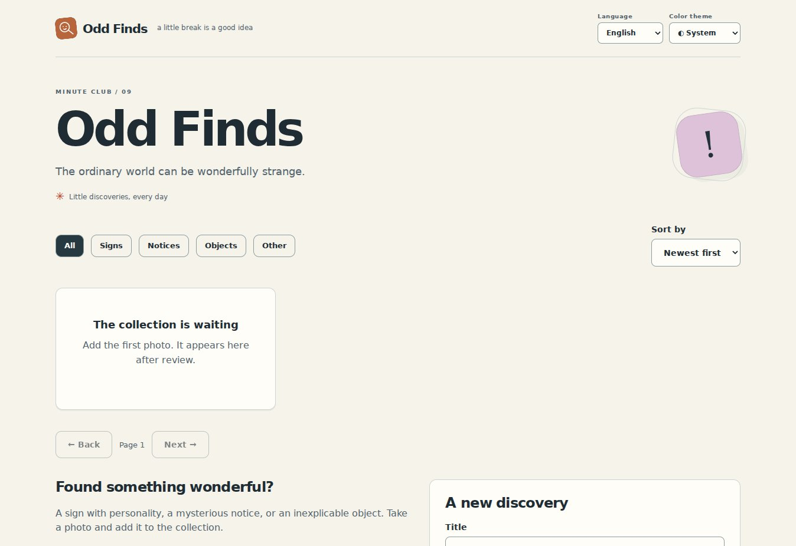

> Node.js 24+: run `npm ci` before first launch / Перед первым запуском выполните `npm ci`.

<div align="center">


# Odd Finds

**The everyday, slightly stranger.**

Collect funny signs, strange notices, and things that deserve a second look.

**English** · [Русский](README.ru.md)

  

</div>

[Features](#features) · [Stack](#technology-stack) · [Quick start](#quick-start) · [License](LICENSE)



*Actual local application capture with an empty test database; this is not audience activity.*

## Features

- A community collection of visual finds
- Search approved finds by title and description
- Image submissions reviewed before publication
- JPEG, PNG, and WebP input with browser compression

**Try the flow: Spot something → submit → moderation → publish.**

Documentation: English / Русский. App interface: English, Русский, selected from browser preferences or manually. System theme by default, with explicit light and dark modes. The system mode follows device changes; your choice is saved locally.

## Technology stack

| Layer | Implementation |
| --- | --- |
| Interface | HTML · CSS · JavaScript / native ES modules |
| Runtime | Node.js 24+ · SQLite |
| Development | JavaScript |
| Dependencies | No third-party browser libraries or remote fonts |

## Quick start

Requires Node.js 24+. Run npm ci before first launch.

```sh
npm ci
npm start
```

Open http://localhost:3000. The root opens this application; unrelated app routes and APIs are disabled. Data persists in `data/minute.sqlite`.

```sh
npm test
npm run check
```

## Enable image submissions

Set `ADMIN_TOKEN` to a long random secret before starting. Without a key, uploads are disabled. Review submissions at `/admin/`. Images remain private until approved. The browser compresses JPEG/PNG/WebP to 500 KB; the server validates size, signature, and dimensions. Animated files are not supported in v1. This project defaults to **40 GB** of accepted media.

## Deploy

Set `PUBLIC_ORIGIN` to the exact HTTPS origin, give the process a persistent `DATA_DIR`, and put an HTTPS reverse proxy in front. Example Dockerfile, Caddy config, environment file, and systemd unit are included. Each independent project needs its own port and data directory. `.env` is not loaded automatically: use exported variables or `node --env-file=.env server/index.mjs`. See [OPERATIONS.md](OPERATIONS.md) for backups, moderation, identity limitations, and storage details.


---

[More by den9911](https://github.com/den9911) · [Report an issue](https://github.com/den9911/odd-finds/issues) · [LICENSE](LICENSE)


## Recent improvements / Последние улучшения

Image submissions accept an optional description up to 240 characters. It is used as alt text, with the title as a legacy fallback, and can be edited by a moderator without changing publication status. User descriptions are not automatically translated.

У загрузки есть описание до 240 символов для alt; модератор может исправить его без смены статуса. Старые записи используют заголовок, пользовательский текст автоматически не переводится.

Startup diagnostics / Проверка запуска: `node server/index.mjs --check` checks the local address, configuration and writable data location without creating a database or starting the API. To use another port: `--port 3005`. No tokens are printed. / База и сервер при проверке не создаются; секреты не выводятся.


## Pixel decoding and upload retry — 12 November

Install with npm ci (Node.js 24); sharp 0.35.5 is now a pinned runtime dependency. A successful signature/dimension inspection is followed by a complete raw pixel decode with strict warning handling. PNG/JPEG/WebP stay supported. Limits: 500,000 input bytes, 2048×2048 pixels, two active decodes, no waiting queue, native decoder timeout 3 seconds, disabled libvips cache and one thread per operation. These are work limits, not a measured hard process-RSS limit or sandbox. Invalid images are never inserted as pending. The original accepted buffer is stored; server metadata stripping is not claimed by this change.

The browser attaches requestId and keeps it for an unchanged retry. A matching owner/key/payload returns the saved post; changed payload with the same key returns 409, a deleted post returns 410. Receipt and post are committed together, with a second lookup inside the transaction to handle simultaneous decodes. Editing the form creates a new key. Reload/legacy clients without requestId do not get a global deduplication guarantee. Receipts retain only owner, key, fingerprint and post ID; total retention remains a separate policy. Back up before the additive table migration. Docker now installs pinned production dependencies.
